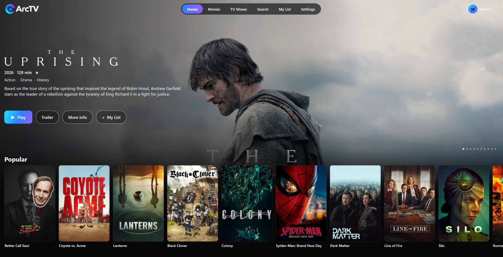

<h1 align="center">Arc TV for Windows</h1>

<p align="center"><b>Your streaming, your way, on your PC.</b><br>
A native, Netflix-style streaming app for Stremio-protocol addons, built with C# and WPF.</p>

<p align="center">
  <a href="https://github.com/MikeC444/ArcTV-Windows/releases/latest"><b>Download for Windows</b></a> ·
  <a href="#-installing">Install it</a> ·
  <a href="https://arctv.org">arctv.org</a>
</p>

<p align="center">
  
</p>

> **Early version.** 0.1.x is the first public release. It works, and it is still young: expect rough edges, and please tell us what you find.

Arc TV is a modern media center for Windows 10 and 11. Content comes from **Stremio addons** rather than a fixed catalog, so you choose the addons you want, the same way Stremio itself works. Arc TV ships with no content of its own.

It is a native Windows app (not a web page in a window) for **64-bit Windows 10 and 11**, and it uses the same account as the [Mac app](https://github.com/MikeC444/ArcTV-Mac), the [Fire TV, Firestick and Android TV app](https://github.com/MikeC444/ArcTV-AndroidTV), the [phone app](https://github.com/MikeC444/ArcTV-MobileAPK) and the [web app](https://web.arctv.org), so your list and addons are already there when you sign in.

## ✨ Features

- **Addon-powered**: discover movies and series from whichever Stremio-protocol addons you install, and add, switch off or remove them from the app. If you have none yet, a step-by-step guide walks you through setting up a debrid service and sources
- **Sync everywhere**: your My List, Continue Watching, settings and addons follow you between your PC, your Mac, your TV, your phone and the web
- **A player that plays more**: the built-in player (mpv) plays 4K, HEVC, HDR and Dolby Vision files, with audio, subtitle and speed menus, subtitle files fetched from your addons in your language, an Episodes list for shows, next episode and autoplay, full screen, and it remembers your volume and speed
- **Torrents inside the app**: torrent sources play right inside Arc TV, with settings for the buffer size and how much disk space a torrent may use
- **Made for Windows**: right-click any poster for a quick menu (Play, My List, Watched, Like and Not for me), a dark title bar, a top bar that slides away as you scroll, and a window that scales from a laptop to a big monitor
- **Easy sign-in**: sign in with your email and password, or scan a QR code with your phone. Your sign-in is kept in an encrypted file only your Windows account can read
- **Browse your way**: Home, Movies, TV Shows, Search and My List, with a title page showing the logo, trailer, rating, cast and more like it, and a source list with quality filters and sorting. Blocked genres stay out of sight
- **Picked for you**: a Home row chosen from the movies and shows you like, finish and save, with the reason under each poster
- **Stays up to date**: Arc TV tells you when a new version is out and what changed
- **ArcTV Plus** (optional; the app stays free): up to 5 profiles with kids profiles and PIN locks, Picked for you, Smart source picking, and a **Download** button that saves movies and episodes to a folder you pick, with a Downloads page to follow them

## 📱📺 Arc TV everywhere

Same account, same list, same addons on every device:

| | |
|---|---|
| 🪟 **Windows** | this repository |
| 💻 **Mac** | [ArcTV-Mac](https://github.com/MikeC444/ArcTV-Mac) |
| 📺 **Fire TV / Firestick / Android TV / Google TV** | [ArcTV-AndroidTV](https://github.com/MikeC444/ArcTV-AndroidTV), also home of the account backend (`server/`) |
| 📱 **Android phones and tablets** | [ArcTV-MobileAPK](https://github.com/MikeC444/ArcTV-MobileAPK) |
| 🌐 **Web** | [web.arctv.org](https://web.arctv.org) ([ArcTV-Web](https://github.com/MikeC444/ArcTV-Web)) |

## 🪟 Installing

1. Download **`ArcTV-Setup-<version>.exe`** from [the latest release](https://github.com/MikeC444/ArcTV-Windows/releases/latest) and run it. It installs for your own Windows account only, so it does not ask for administrator rights.
2. The app is **not code-signed yet**, so Windows may show **"Windows protected your PC"** (SmartScreen) the first time: choose **More info**, then **Run anyway**.
3. Open **Arc TV** from the Start menu, sign in with your Arc TV email and password (or create an account), and add an addon if you don't have one yet.

Prefer no installer? Download **`ArcTV-win-x64-<version>.zip`** from the same page, unzip it anywhere and run `ArcTV.exe`. It carries everything it needs, so there is nothing else to install, not even .NET.

## ❓ Questions

**Where do the movies and shows come from?** From the Stremio addons you add. Arc TV only plays what an addon provides and does not host or supply any content.

**Is it free?** Yes. Browsing, playing, My List, Continue Watching and addons are free. ArcTV Plus adds extras on top.

**Is Arc TV affiliated with Stremio?** No. Arc TV is an independent app that supports the Stremio addon format, so addons made for Stremio work in it. It is not affiliated with or endorsed by Stremio.

**Why the "Windows protected your PC" warning?** The installer isn't code-signed yet, so Windows doesn't know the publisher. Choose **More info**, then **Run anyway**.

**Windows Firewall asked me about Arc TV. Why?** Playing a torrent means Arc TV connects to other people sharing it, and Windows may ask whether to allow that the first time. Allow it on private networks (and public ones if you use Arc TV away from home) for the best speeds.

**A video won't start, or looks wrong. What now?** Arc TV keeps two small log files in `%LOCALAPPDATA%\ArcTV` (type that into the File Explorer address bar): `player.log` and `mpv.log`. Include them when you report a problem.

**Does it run on Windows on ARM, or Windows 7 and 8?** Not tested, and not supported. It is built for 64-bit Windows 10 and 11.

## 🛠️ For developers

The app is C# on .NET 8 with WPF, and talks to the same account backend and Stremio-protocol addons as the other Arc TV apps (the backend lives in the Fire TV repository's `server/`). The logic that isn't on screen is ported from the [Mac app](https://github.com/MikeC444/ArcTV-Mac)'s `ArcTVCore`, so the two behave alike.

### Building

Needs Visual Studio 2022 or later (the **.NET desktop development** workload) or the .NET 8 SDK. The video engine, libmpv, isn't kept in git: the first build on Windows downloads it (`scripts/get-libmpv.ps1`, an LGPL build, so Arc TV doesn't have to be released under the GPL).

```
git clone https://github.com/MikeC444/ArcTV-Windows
cd ArcTV-Windows
dotnet test ArcTV.sln                  # the tests (ArcTV.Core logic, and the screens on Windows)
dotnet run --project src/ArcTV.App     # run the app (or open ArcTV.sln in Visual Studio and press F5; if Visual Studio says a class library cannot be started, right-click **ArcTV.App** in Solution Explorer and choose **Set as Startup Project**)
.\scripts\try-branch.ps1 <branch>      # fetch, build and open any branch
```

The backend address is baked in from the `API_BASE_URL` secret when the release workflow publishes. It can also be typed on the sign-in screen, so a build without it still works.

### Layout

- `src/ArcTV.Core`: everything that isn't on screen (addon protocol, account API, Home rows, recommendations, downloads), ported from the Mac app's `ArcTVCore`.
- `src/ArcTV.App`: the WPF app (the player is mpv through libmpv; torrents are MonoTorrent).
- `tests/ArcTV.Core.Tests` and `tests/ArcTV.App.Tests`: xUnit tests (the screen tests need Windows).
- `installer/ArcTV.iss`: the Inno Setup script for the installer.
- `.github/workflows/build.yml`: builds and tests every push and keeps the app as a zip you can download from the run.
- `.github/workflows/release.yml`: on a version tag or a manual run, builds the installer and zip and publishes a GitHub Release with the patch notes.

### Releasing

Add each user-visible change as a bullet under `## Unreleased` in `RELEASE_NOTES.md`, then run the **Build and publish release (Arc TV Windows)** workflow with a version (for example `0.1.1`) and **Publish a GitHub Release** ticked. Leave it unticked for a trial run: the installer and zip are built and kept with the run, and nothing is published. The notes under Unreleased become the release's notes and are filed under the version afterwards.

Arc TV only plays what an addon provides and does not host or supply any content. It is not affiliated with or endorsed by Stremio.
